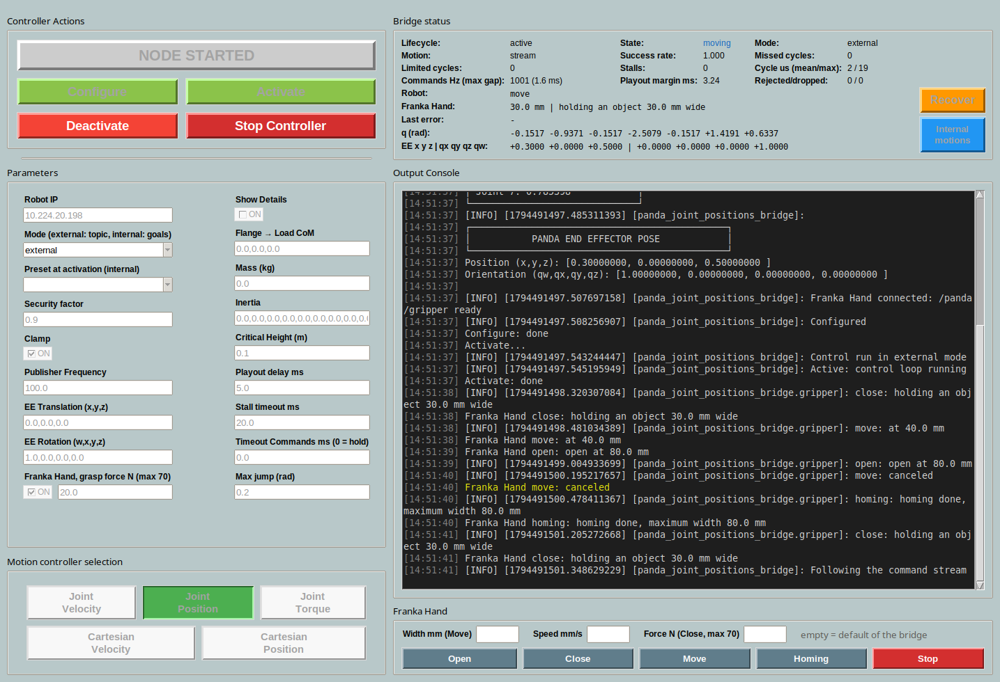
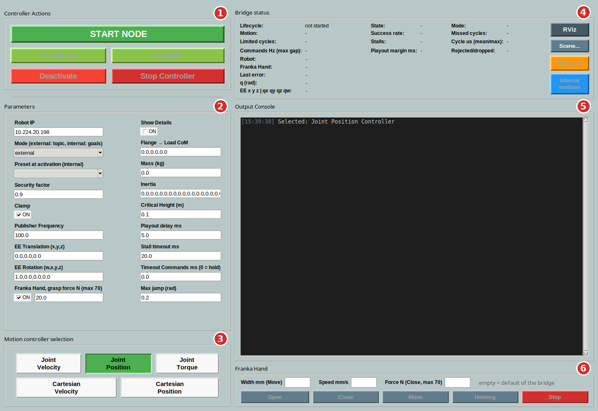
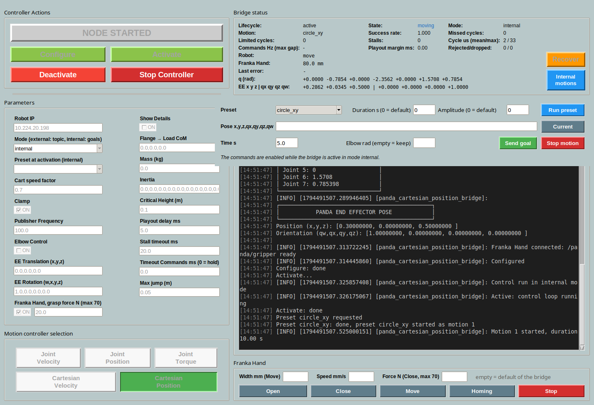
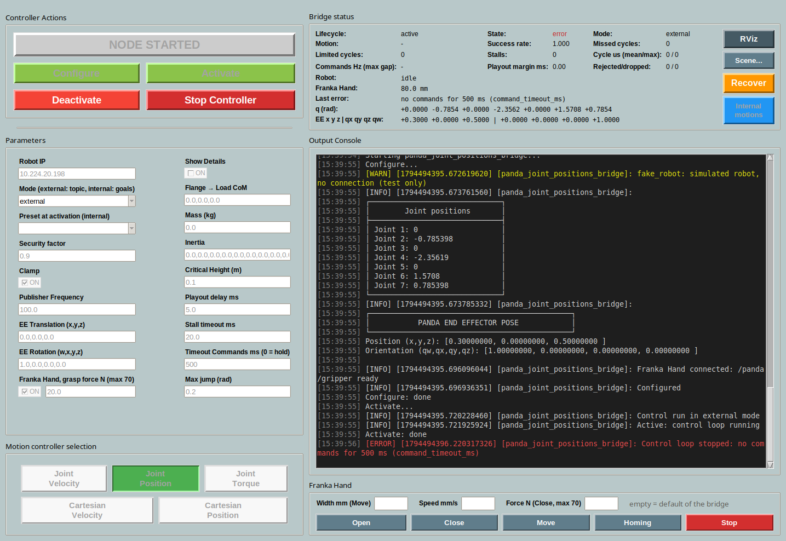

<p align="right">
  <a href="README.md"></a>
  <a href="README.en.md"></a>
</p>

# uclv_panda_ros2: ROS 2 driver for the Franka Panda

ROS 2 Jazzy driver for the Franka Panda (FER, System 4.x) with libfranka 0.9.2. You use it from a GUI, or by commanding the robot from your own nodes through topics. For the Franka Research 3 (FR3) use [franka_ros2](https://github.com/frankaemika/franka_ros2) instead.



The code before this version is on the [`old`](https://github.com/gianmarcodipuorto/uclv_panda_ros2/tree/old) branch.

## Contents

1. [How it works](#how-it-works)
2. [Installation](#installation)
3. [Real-time PC](#real-time-pc)
4. [Connecting the robot](#connecting-the-robot)
5. [Quick start](#quick-start)
6. [The GUI](#the-gui)
7. [Commanding the robot from your own program](#commanding-the-robot-from-your-own-program)
8. [Internal motions: goals and presets](#internal-motions-goals-and-presets)
9. [State, errors and recovery](#state-errors-and-recovery)
10. [Parameters](#parameters)
11. [Trying it without a robot](#trying-it-without-a-robot)
12. [Robot tests](#robot-tests)
13. [Automated tests](#automated-tests)

## How it works

For each way of commanding the robot there is a node, called a **bridge**, that connects to the robot through libfranka. You use one bridge at a time, usually started from the GUI.

| In the GUI | Executable | Commands | Command topic |
|---|---|---|---|
| Joint Position | `panda_joint_positions_bridge` | joint positions | `/panda/joint_position_command` |
| Joint Velocity | `panda_joint_velocities_bridge` | joint velocities | `/panda/joint_velocity_command` |
| Joint Torque | `panda_joint_torques_bridge` | joint torques | `/panda/joint_torque_command` |
| Cartesian Position | `panda_cartesian_position_bridge` | end-effector pose | `/panda/cartesian_position_command` |
| Cartesian Velocity | `panda_cartesian_velocity_bridge` | end-effector velocity | `/panda/cartesian_velocity_command` |

Each bridge has two modes, chosen with the `mode` parameter:

- **`external`**: the robot follows the commands that another node publishes on the topic, as with a ros_control "forward" controller.
- **`internal`**: the bridge generates the motion itself, towards a goal (action) or as a predefined motion (preset).

The bridge sends a command to the robot every millisecond, always: the client does not have to. It plays back the commands it receives according to their timestamps, adapts them to the robot's limits and, if the client stops publishing, stops the robot smoothly.

How it works inside, and where the files are: [docs/ARCHITETTURA.en.md](docs/ARCHITETTURA.en.md).

## Installation

You need:

- a Panda (FER) with System 4.2.1 or a later 4.x version, with the FCI feature installed (in Desk: Settings → System → Installed Features);
- a PC with Ubuntu 24.04, [ROS 2 Jazzy](https://docs.ros.org/en/jazzy/Installation/Ubuntu-Install-Debs.html) and a real-time kernel (see [Real-time PC](#real-time-pc));
- **libfranka 0.9.2**, the last version compatible with the Panda, built from source.

```bash
# 1. libfranka 0.9.2, in ~/libfranka
sudo apt install -y build-essential cmake git libpoco-dev libeigen3-dev
git clone --recursive --branch 0.9.2 https://github.com/frankaemika/libfranka.git ~/libfranka
cd ~/libfranka && mkdir build && cd build
cmake -DCMAKE_BUILD_TYPE=Release -DBUILD_TESTS=OFF ..
cmake --build . -j4 && sudo cmake --install . && sudo ldconfig

# 2. ROS, GUI and build dependencies
sudo apt install -y ros-jazzy-ruckig ros-jazzy-realtime-tools python3-tk qtbase5-dev python3-colcon-common-extensions

# 3. this repository, in ~/uclv_panda_ros2
git clone https://github.com/gianmarcodipuorto/uclv_panda_ros2.git ~/uclv_panda_ros2
cd ~/uclv_panda_ros2
source /opt/ros/jazzy/setup.bash
colcon build --packages-select uclv_panda_interfaces panda_utils --cmake-args -DCMAKE_BUILD_TYPE=Release
source install/setup.bash
```

The commands on this page assume the repository is in `~/uclv_panda_ros2`: if you clone it somewhere else, change the path. To avoid repeating the `source` in every terminal: `echo "source ~/uclv_panda_ros2/install/setup.bash" >> ~/.bashrc`.

> Do not install `ros-jazzy-libfranka`: it is a newer version, for the FR3 only, and CMake could pick it up instead of 0.9.2.

> Close the bridge before rebuilding (Stop Controller in the GUI). colcon cannot overwrite an executable in use, and only one bridge at a time can connect to the robot. If the GUI is already closed and a bridge is still running: `pkill -INT -f lib/panda_utils/panda_`.

## Real-time PC

libfranka needs a real-time kernel and the permissions to use it: without them, the bridge fails on Configure. You set this up once.

1. **PREEMPT_RT kernel.** On Ubuntu 24.04 the easiest way is the Ubuntu Pro real-time kernel, free for personal use:
   ```bash
   sudo pro attach                    # with the token of your Ubuntu Pro account
   sudo pro enable realtime-kernel
   ```
   Alternatively, build it following [Franka's guide](https://frankarobotics.github.io/docs/doc/libfranka/docs/real_time_kernel.html). After the reboot, `uname -v` must contain `PREEMPT_RT`.
2. **Real-time permissions** for your user:
   ```bash
   sudo addgroup realtime
   sudo usermod -a -G realtime $(whoami)
   ```
   Then add these lines to `/etc/security/limits.conf`, and log out and back in. `ulimit -r` must print 99.
   ```
   @realtime soft rtprio 99
   @realtime soft priority 99
   @realtime soft memlock 102400
   @realtime hard rtprio 99
   @realtime hard priority 99
   @realtime hard memlock 102400
   ```

To reduce latency, after every reboot (replace `<interface>` with the network card connected to the robot, which you find with `ip link`):

```bash
echo performance | sudo tee /sys/devices/system/cpu/cpu*/cpufreq/scaling_governor
echo 1 | sudo tee /sys/devices/system/cpu/cpu*/cpuidle/state[23]/disable   # C2 and C3
sudo ethtool -C <interface> rx-usecs 0
```

The names of the CPU sleep states are in `/sys/devices/system/cpu/cpu0/cpuidle/state*/name`: on another CPU, C2 and C3 may have different numbers.

Worth considering: the network card interrupts on the same CPU as the loop (`rt_cpu`), and a network card dedicated to the robot. If Configure or the robot report communication errors, follow [Franka's troubleshooting](https://frankarobotics.github.io/docs/troubleshooting.html).

## Connecting the robot

1. Connect the PC to the LAN port of the **Control**, not to the one in the base of the arm. A direct cable, without a switch, is better.
2. Give the PC network card a static address in the same network as the robot: for example, if the robot is `172.16.0.2`, the PC can be `172.16.0.1` with netmask `255.255.255.0` (Ubuntu network settings → wired connection → manual IPv4).
3. Open Desk in the browser at `https://<robot-ip>`. Unlock the brakes and activate FCI from the top menu (**Activate FCI**).
4. Check the connection:
   ```bash
   ping -c 3 <robot-ip>
   ~/libfranka/build/examples/echo_robot_state <robot-ip>   # prints the robot state
   sudo ping <robot-ip> -i 0.001 -D -c 10000 -s 1200         # network quality
   ```
   In the last test the round-trip times must stay well below 1 ms, the length of one cycle.
5. In the GUI, write the address in **Robot IP**; when you launch a bridge by hand, use `-p robot_ip:=<robot-ip>`. The default, `10.224.20.198`, is the address of the robot the driver was written for.

## Quick start

1. Prepare the robot as in [Connecting the robot](#connecting-the-robot): brakes unlocked and FCI active. Keep the user stop in your hand.
2. Start the GUI:
   ```bash
   source ~/uclv_panda_ros2/install/setup.bash
   ros2 launch panda_utils gui.launch.py
   ```
3. At the bottom left, choose the bridge, for example **Joint Position**.
4. Check the parameters: at least **Robot IP** (the address of your robot) and **Mode**.
5. Press **START NODE**, then **Configure**, then **Activate**. The robot now holds its position.
6. Move the robot. In `external` mode, from another terminal:
   ```bash
   source ~/uclv_panda_ros2/install/setup.bash
   ros2 run panda_utils simple_joints_traj   # the 7 joints decrease by 0.2 rad in 2 s
   ```
   In `internal` mode the **Internal motions** window opens, where you start a preset or a goal.
7. When you are done, press **Stop Controller** or close the window: the robot stops smoothly and the bridge exits.

## The GUI



| | Part | What it is for |
|---|---|---|
| 1 | **Controller Actions** | starts the bridge and takes it through its states (table below) |
| 2 | **Parameters** | parameters of the chosen bridge; they are locked while the bridge is running |
| 3 | **Motion controller selection** | which bridge to start: joint bridges on the first row, Cartesian ones on the second |
| 4 | **Bridge status** | state of the bridge and of the robot, updated 5 times per second; **Recover** and **Internal motions** buttons |
| 5 | **Output Console** | the log of the GUI and of the bridge: errors in red, warnings in yellow |

The buttons are enabled only when the action is possible:

| Button | What happens |
|---|---|
| START NODE | launches the chosen bridge with the GUI parameters |
| Configure | connects to the robot and applies the settings (collisions, impedances, load, end effector); the console shows the tables of the initial state. From here on the robot state is published |
| Activate | starts the 1 kHz control loop; the robot holds its position |
| Deactivate | smooth stop, then the loop ends; the robot stays connected |
| Stop Controller | Deactivate (if active), then closes the bridge |

If a step fails, for example Configure with the robot unreachable, an error pops up and the console says why.

Closing the window, or pressing Ctrl+C in the launch terminal, first stops the robot and then closes the GUI and the bridge.

### During a motion

The screenshot at the top of the page shows the Joint Position bridge while it follows the stream of `simple_joints_traj`. In the **Bridge status** panel, the fields to watch are:

- **State**: `holding` (holding its position), `moving`, `stopping`, `error`;
- **Success rate**: the fraction of commands that reached the robot; it should stay close to 1;
- **Commands Hz (max gap)**: the rate at which the client publishes, and the longest gap between two messages;
- **Stalls**: how many times the stream broke off while the robot was moving, and the bridge stopped it;
- **Limited cycles**: how many times the bridge had to correct a command that the robot would not have accepted.

### Internal mode



Choosing **Mode** `internal` opens the **Internal motions** window. If you close it, reopen it with the **Internal motions** button of the status panel. The controls are enabled when the bridge is active:

- **Run preset**: starts a predefined motion, with duration and amplitude (0 = default value);
- **Current** fills the goal with the current position (or pose): change a value, choose the time and press **Send goal**;
- **Elbow rad** (Cartesian bridges only, with `use_elbow_control`): elbow position to reach, empty to keep it;
- **Stop motion** stops the current motion smoothly.

| Bridge | Presets | Goal |
|---|---|---|
| joint | `quintic_joint1` (joint 1 forward by 0.2 rad in 10 s), `sine_joint1` (joint 1 back and forth) | 7 joint positions |
| Joint Torque | the same, plus `gravity_compensation` (you move the robot by hand) | 7 joint positions, tracked in impedance |
| Cartesian | `line_x` (10 cm along x and back), `circle_xy` (5 cm circle in the horizontal plane) | pose `x,y,z,qx,qy,qz,qw` in the base frame |

### Errors and Recover



After a robot reflex, the user stop or a bridge error, **State** becomes `error`, the cause appears in **Last error** and in red in the console, and **Recover** is enabled. Recover runs the libfranka recovery procedure and, if the bridge is active, the robot holds its position again.

In the screenshot the bridge stopped because it had received no commands for more than 500 ms (parameter **Timeout Commands ms**).

## Commanding the robot from your own program

In `external` mode the robot follows the messages published on the topic of the active bridge:

| Bridge | Topic | Type | Content |
|---|---|---|---|
| Joint Position | `/panda/joint_position_command` | `uclv_panda_interfaces/JointsCommandedPositions` | `positions`: 7 positions (rad) |
| Joint Velocity | `/panda/joint_velocity_command` | `sensor_msgs/JointState` | `velocity`: 7 velocities (rad/s) |
| Joint Torque | `/panda/joint_torque_command` | `sensor_msgs/JointState` | `effort`: 7 torques (Nm), **without gravity** |
| Cartesian Position | `/panda/cartesian_position_command` | `geometry_msgs/PoseStamped` | end-effector pose in the base frame |
| Cartesian Velocity | `/panda/cartesian_velocity_command` | `geometry_msgs/TwistStamped` | end-effector velocity in the base frame |

### The rules

1. **Put in `header.stamp` the instant the sample refers to.** The bridge plays the samples back in that order and at those times, `playout_delay_ms` after the stamp: this way network delays do not reach the robot. With a zero stamp the bridge uses the arrival time.
2. **Publish at the rate you have.** 1 kHz is not needed: the bridge interpolates between the samples. Adjust two parameters, though:

   | The client publishes at | Playout delay ms | Stall timeout ms |
   |---|---|---|
   | 1 kHz | 5 (default; torques 1) | 20 (default) |
   | 100 Hz | 15 | 20 (default) |
   | 40 Hz (every 25 ms) | 30 | 50 |

   In general: `playout_delay_ms` at least the period plus 5 ms, `stall_timeout_ms` at least two periods. The price is a delay equal to `playout_delay_ms`.
3. **Do not repeat the same value to keep the stream alive.** The bridge reads the stamps: 25 identical samples followed by a jump mean "stand still, then jump", and the robot vibrates. Publish new samples when you have them.
4. **Start from the current command.** The first sample must be close to where the robot is commanded now: `q_d` or `o_t_ee_d` in `/panda/robot_state`. A stream of positions or poses that starts more than `max_jump` away is rejected.
5. **When you stop publishing**, the bridge stops the robot smoothly and holds its position. For positions and poses it stays at the last point received. For velocities and torques it brakes to a stop after `stall_timeout_ms`: to keep a velocity you have to keep publishing it.
6. **Torques are without gravity**: the robot compensates gravity, as in libfranka.

Poses and twists are in the base frame (`fer_link0`), with the quaternion in x, y, z, w order. The sign of the quaternion does not matter.

### A Python example

[`src/panda_utils/examples/joint_position_client.py`](src/panda_utils/examples/joint_position_client.py) moves joint 1 by 0.2 rad in 4 s, publishing at 100 Hz:

```python
def on_state(self, msg):
    # The stream starts from the position commanded now (q_d), then a timer publishes at 100 Hz
    if self.start is None:
        self.start = list(msg.q_d)
        self.t0 = self.get_clock().now()
        self.create_timer(0.01, self.publish)

def publish(self):
    t = min((self.get_clock().now() - self.t0).nanoseconds * 1e-9, DURATION)
    cmd = JointsCommandedPositions()
    cmd.header.stamp = (self.t0 + Duration(nanoseconds=int(t * 1e9))).to_msg()  # instant of the sample
    cmd.positions = list(self.start)
    s = t / DURATION
    cmd.positions[0] += 0.2 * (10 * s**3 - 15 * s**4 + 6 * s**5)  # quintic: starts and ends at rest
    self.pub.publish(cmd)
    if t == DURATION:
        raise SystemExit  # last sample, at rest: the bridge holds this position
```

To try it, start **Joint Position** in `external` mode with **Playout delay ms** = 15, then run

```bash
python3 ~/uclv_panda_ros2/src/panda_utils/examples/joint_position_client.py
```

At the end, **Stalls** and **Limited cycles** in the status panel must be 0.

### The reference clients

Each bridge has a ready-made client that publishes at 1 kHz:

```bash
ros2 run panda_utils simple_joints_traj                          # positions: the 7 joints decrease by 0.2 rad in 2 s
ros2 run panda_utils simple_velocity_traj q1 q2 q3 q4 q5 q6 q7   # velocities: goes to the 7 given positions in 5 s
ros2 run panda_utils simple_torque_cmd 10                        # zero torques for 10 s: the robot "floats"
ros2 run panda_utils simple_cartesian_traj 0.05 0 0 5            # pose: 5 cm along x in 5 s
ros2 run panda_utils simple_cartesian_traj 0.4 0 0.4 1 0 0 0 5   # pose: to the pose x y z qx qy qz qw in 5 s
ros2 run panda_utils simple_cartesian_traj 0.05 0 0 5 --velocity # the same motion, as a twist
```

With `simple_velocity_traj`, always pass 7 positions close to the current ones: without arguments it goes to a fixed configuration far away. You can read the current pose with `ros2 topic echo --once /pose_state_read_ee`, in the same format that `simple_cartesian_traj` expects.

## Internal motions: goals and presets

Besides the GUI, `internal` motions can be commanded from the command line:

```bash
# joint goal: positions and duration
ros2 action send_goal --feedback /panda/joint_traj uclv_panda_interfaces/action/JointTraj \
  "{desired_joint_cmd: {position: [0.0, -0.785, 0.0, -2.356, 0.0, 1.571, 0.785]}, total_time: 5.0}"

# Cartesian goal: pose, duration, elbow (.nan keeps it)
ros2 action send_goal --feedback /panda/cart_traj uclv_panda_interfaces/action/CartTraj \
  "{desired_pose: {position: {x: 0.4, y: 0.0, z: 0.4}, orientation: {x: 1.0, y: 0.0, z: 0.0, w: 0.0}}, total_time: 5.0, desired_elbow: .nan}"

# preset (duration and amplitude are optional)
ros2 service call /panda/run_preset uclv_panda_interfaces/srv/RunPreset "{preset: quintic_joint1}"

# stop the current motion
ros2 service call /panda/stop_motion std_srvs/srv/Trigger
```

A goal that would take the robot beyond its joint limits is rejected; one that is too fast is slowed down until it respects the limits.

## State, errors and recovery

From Configure on, every bridge publishes:

| Topic | Type | Content |
|---|---|---|
| `/joint_states` | `sensor_msgs/JointState` | joint positions, velocities and torques |
| `/panda/robot_state` | `uclv_panda_interfaces/PandaRobotState` | full state: `q`, `q_d`, velocities, torques, poses (`o_t_ee`, `o_t_ee_d`), external forces, robot mode and errors |
| `/pose_state_read_ee` | `geometry_msgs/PoseStamped` | end-effector pose read from the robot |
| `/pose_state_computed_ee` | `geometry_msgs/PoseStamped` | flange pose computed from the model |
| `/panda/bridge_status` | `uclv_panda_interfaces/BridgeStatus` | bridge state and diagnostics: the same fields as the GUI panel |

```bash
ros2 topic echo /panda/bridge_status                              # diagnostics
ros2 service call /panda/error_recovery std_srvs/srv/Trigger      # recovery after an error (= Recover)
```

What the bridge does in the other cases:

| Event | What happens |
|---|---|
| the client stops publishing | smooth stop, then the robot holds its position |
| the end effector goes below `critical_height` | smooth stop, then the loop ends with an error |
| robot reflex or user stop | `error`; after Recover the robot holds its position again |
| Ctrl+C on the bridge, or its terminal is closed | smooth stop, then the bridge exits |
| the GUI dies abruptly | the bridge keeps holding the robot; the next GUI reports it on Start |

## Parameters

Set the parameters in the GUI before START NODE, or with `--ros-args -p name:=value` when you launch a bridge by hand.

Common to all bridges:

| Parameter | Default | Meaning |
|---|---|---|
| `robot_ip` | `10.224.20.198` | robot address: set yours |
| `mode` | `external` | `external` (commands from the topic) or `internal` (goals and presets) |
| `auto_preset` | empty | preset to start on activation (internal) |
| `publish_freq` | 100 | rate (Hz) of the published state and status |
| `playout_delay_ms` | 5 (torques: 1) | playback delay of the samples (see [the rules](#the-rules)) |
| `stall_timeout_ms` | 20 | stream gap beyond which the robot is stopped |
| `command_timeout_ms` | 0 | with no commands for this long the loop ends; 0 = hold the position forever |
| `clamp` | true | a command beyond the limits is saturated; with false it stops the robot |
| `critical_height` | 0.1 | minimum end-effector height (m) |
| `flange_T_ee_translation`, `flange_T_ee_rotation` | 0, `[1,0,0,0]` | flange → end effector (quaternion w, x, y, z) |
| `load`, `F_x_Cload`, `load_inertia` | 0 | mass, center of mass and inertia of the load |
| `show_details` | false | on Configure, also prints the Jacobian, mass matrix and Coriolis |
| `collision_{lower,upper}_{torque,force}_thresholds` | as in the libfranka examples | collision thresholds |
| `joint_impedance`, `cartesian_impedance` | as in the libfranka examples | impedances of the robot's internal controller |
| `limit_rate`, `lpf_cutoff_frequency` | true, 100 | libfranka rate limiter and filter |
| `rt_cpu`, `lock_memory`, `executor_rt_priority` | -1, false, 0 | real time: CPU dedicated to the loop, mlock, executor priority |
| `fake_robot` | false | simulated robot, to try things without a robot |

Joint bridges:

| Parameter | Default | Bridge | Meaning |
|---|---|---|---|
| `safe_joint_speed_factor`, `_acceleration_factor`, `_jerk_factor` | 0.9, 0.8, 0.5 | all | fraction of the robot's velocity, acceleration and jerk limits |
| `joint_limit_margin` | 0.01 | all | margin from the joint limits (rad) |
| `max_jump` | 0.2 | positions | maximum distance (rad) of the first sample of a stream |
| `controller_mode` | `joint_impedance` | positions, velocities | the robot's internal controller |
| `safe_torque_factor` | 0.9 | torques | fraction of the torque limits (87 Nm joints 1-4, 12 Nm joints 5-7) |
| `torque_rate_factor` | 0.5 | torques | fraction of the torque rate limit (1000 Nm/s) |
| `joint_stiffness` | `[600, 600, 600, 600, 250, 150, 50]` | torques | stiffness (Nm/rad) of internal motions and of the hold |
| `joint_damping` | `[50, 50, 50, 50, 30, 25, 15]` | torques | damping (Nm·s/rad) |

Cartesian bridges:

| Parameter | Default | Meaning |
|---|---|---|
| `safe_speed_factor`, `safe_acceleration_factor`, `safe_jerk_factor` | 0.6, 0.3, 0.3 | fraction of the robot's Cartesian limits |
| `use_elbow_control` | false | also command the elbow (joint 3) |
| `max_jump`, `max_jump_angle` | 0.05, 0.2 | pose only: maximum distance (m, rad) of the first sample of a stream |
| `controller_mode` | `cartesian_impedance` | the robot's internal controller |

With the Cartesian bridges, start from a configuration far from singularities and joint limits: the robot computes the joints itself, and can stop with a reflex that the bridge cannot foresee.

## Trying it without a robot

With `fake_robot:=true` the bridge uses a simulated robot: useful to try a client or the GUI. Use a ROS domain different from the robot's, so that commands never reach a real bridge:

```bash
export ROS_DOMAIN_ID=42 ROS_AUTOMATIC_DISCOVERY_RANGE=LOCALHOST
ros2 run panda_utils panda_joint_positions_bridge --ros-args -p fake_robot:=true
ros2 lifecycle set /panda_joint_positions_bridge configure
ros2 lifecycle set /panda_joint_positions_bridge activate
```

The screenshots on this page were made this way.

## Robot tests

A series of tests to check, the first time, that everything works with your robot and your PC. You need three terminals:

| Terminal | Command | What it is for |
|---|---|---|
| 1 | `ros2 launch panda_utils gui.launch.py` | GUI: choose the bridge and `mode`, then START NODE → Configure → Activate |
| 2 | `ros2 topic echo /panda/bridge_status` | diagnostics during each test |
| 3 | `source ~/uclv_panda_ros2/install/setup.bash` | where you run the commands of the table |

Always keep the user stop in your hand. For the internal tests, set `mode internal` before START NODE.

| # | Bridge | `mode` | Command | What should happen |
|---|---|---|---|---|
| 1 | Joint Position | external | `ros2 run panda_utils simple_joints_traj` | the 7 joints decrease by 0.2 rad in 2 s, then the robot holds its position. A few `limited_cycles` are normal: the client starts from the measured `q` |
| 2 | Joint Position | internal | preset `quintic_joint1` | joint 1 moves forward by 0.2 rad in 10 s |
| 3 | Joint Position | internal | preset `sine_joint1` | joint 1 goes forward and back in 10 s |
| 4 | Joint Position | internal | goal from the GUI: Current, one joint ±0.1 rad, 5 s | the goal is reached |
| 5 | Joint Velocity | external | `simple_velocity_traj` with the current `q` and one joint changed by 0.1 rad | the robot reaches the given positions in 5 s |
| 6 | Joint Velocity | internal | preset `quintic_joint1` | as in test 2 |
| 7 | Joint Torque | internal | Activate only | the robot stays still (hold in impedance) |
| 8 | Joint Torque | internal | preset `quintic_joint1` | as in test 2, in impedance |
| 9 | Joint Torque | internal | preset `gravity_compensation`, then Stop motion | the robot can be moved by hand; after the stop it holds its position |
| 10 | Joint Torque | external | `ros2 run panda_utils simple_torque_cmd 10` | for 10 s the robot floats (hold it with your hand), then it holds its position |
| 11 | Cartesian Position | external | `ros2 run panda_utils simple_cartesian_traj 0.03 0 0 5` | the end effector moves 3 cm along x, with the orientation unchanged |
| 12 | Cartesian Position | external | `simple_cartesian_traj x y z qx qy qz qw 5` with the current pose slightly changed | the end effector reaches the pose |
| 13 | Cartesian Position | internal | preset `line_x` | 10 cm forward along x and back, in 6 s |
| 14 | Cartesian Position | internal | preset `circle_xy` | a circle of 5 cm radius, in 10 s |
| 15 | Cartesian Position | internal | goal from the GUI: Current, z +0.03, 5 s | the goal is reached |
| 16 | Cartesian Velocity | external | `simple_cartesian_traj 0.03 0 0 5 --velocity` | as in test 11 |
| 17 | Cartesian Velocity | internal | preset `line_x` | as in test 13 |
| 18 | any | external | Ctrl+C on the client halfway through the motion | smooth stop, no reflex; `stalls` goes up by 1 |
| 19 | any | | Deactivate and Activate 10 times | every step succeeds |
| 20 | any | | user stop pressed, released, then Recover | `error` and robot `user_stopped`; after Recover `holding` again |
| 21 | any | | Ctrl+C in the GUI terminal with the bridge active | GUI and bridge exit in less than a second |

During each test, in `/panda/bridge_status`: `control_command_success_rate` close to 1, `last_error` empty (except in test 20), `missed_cycles` growing slowly, `stalls` at 0 when a stream ends by itself.

## Automated tests

Without a robot, on an isolated ROS domain:

```bash
cd ~/uclv_panda_ros2
colcon test --packages-select uclv_panda_interfaces panda_utils && colcon test-result --verbose
```

They must all pass: 90 gtests (pipeline, trackers and the five bridges on a simulated robot) plus the `lint_cmake` and `xmllint` linters.
