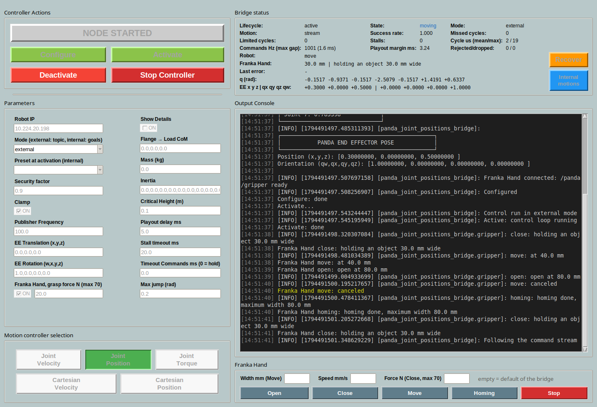
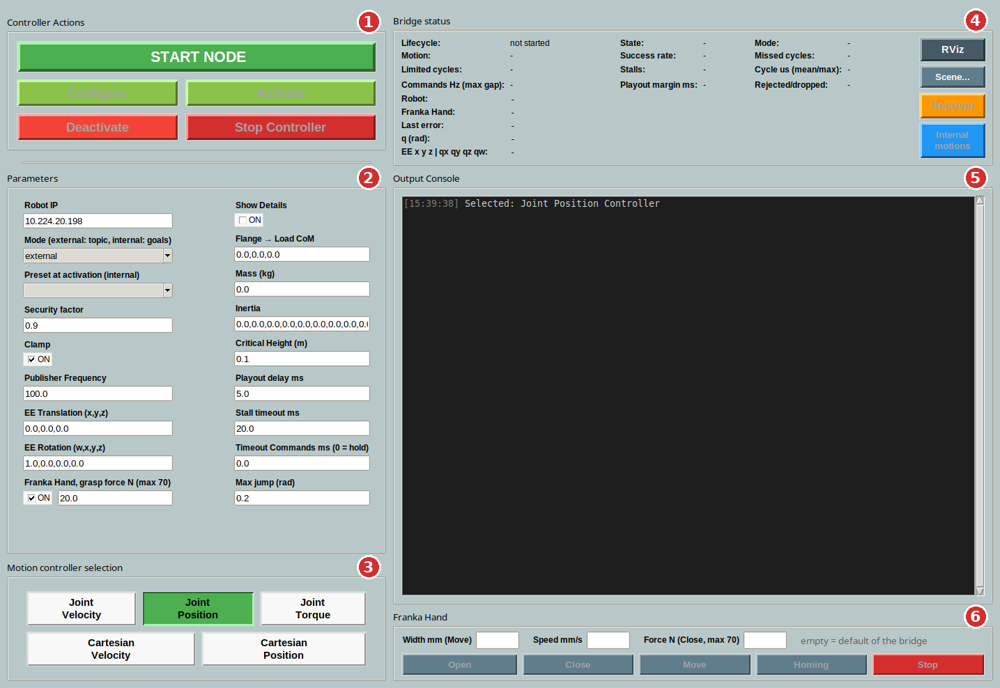
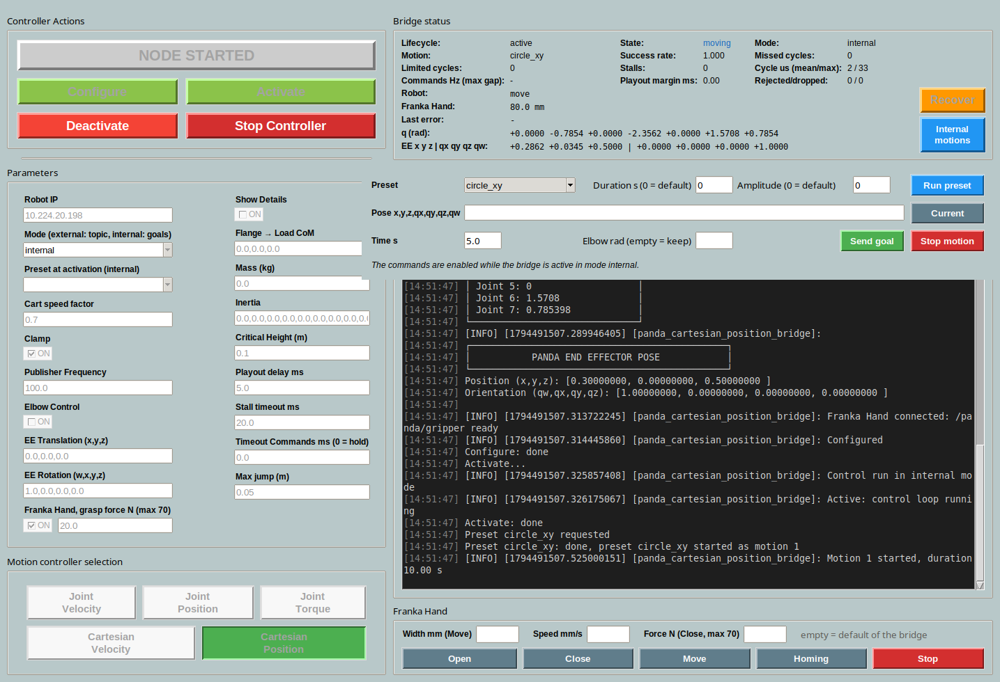
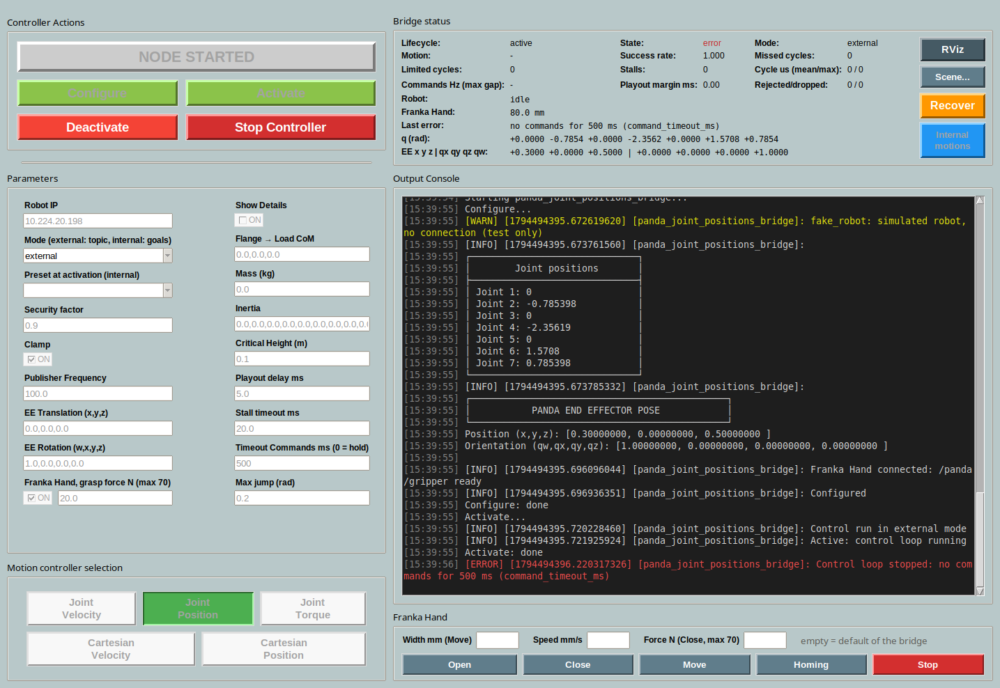

<p align="right">
  <a href="README.md"></a>
  <a href="README.en.md"></a>
</p>

# uclv_panda_ros2: driver ROS 2 per il Franka Panda

Driver ROS 2 Jazzy per il Franka Panda (FER, System 4.x) con libfranka 0.9.2. Si usa da una GUI, oppure comandando il robot dai propri nodi attraverso dei topic. Per il Franka Research 3 (FR3) usa invece [franka_ros2](https://github.com/frankaemika/franka_ros2).



Il codice precedente a questa versione è nel branch [`old`](https://github.com/gianmarcodipuorto/uclv_panda_ros2/tree/old).

## Indice

1. [Come è fatto](#come-è-fatto)
2. [Installazione](#installazione)
3. [PC real-time](#pc-real-time)
4. [Collegare il robot](#collegare-il-robot)
5. [Avvio rapido](#avvio-rapido)
6. [La GUI](#la-gui)
7. [Comandare il robot da un proprio programma](#comandare-il-robot-da-un-proprio-programma)
8. [Moti interni: goal e preset](#moti-interni-goal-e-preset)
9. [Stato, errori e ripresa](#stato-errori-e-ripresa)
10. [Parametri](#parametri)
11. [Provare senza robot](#provare-senza-robot)
12. [Prove sul robot](#prove-sul-robot)
13. [Test automatici](#test-automatici)

## Come è fatto

Per ogni modo di comandare il robot c'è un nodo, chiamato **bridge**, che si collega al robot con libfranka. Si usa un bridge alla volta, di solito avviato dalla GUI.

| Nella GUI | Eseguibile | Comanda | Topic dei comandi |
|---|---|---|---|
| Joint Position | `panda_joint_positions_bridge` | posizioni dei giunti | `/panda/joint_position_command` |
| Joint Velocity | `panda_joint_velocities_bridge` | velocità dei giunti | `/panda/joint_velocity_command` |
| Joint Torque | `panda_joint_torques_bridge` | coppie dei giunti | `/panda/joint_torque_command` |
| Cartesian Position | `panda_cartesian_position_bridge` | posa dell'end effector | `/panda/cartesian_position_command` |
| Cartesian Velocity | `panda_cartesian_velocity_bridge` | velocità dell'end effector | `/panda/cartesian_velocity_command` |

Ogni bridge ha due modalità, scelte con il parametro `mode`:

- **`external`**: il robot segue i comandi pubblicati sul topic da un altro nodo, come con un controller "forward" di ros_control.
- **`internal`**: il moto lo genera il bridge, verso un goal (azione) o con un moto predefinito (preset).

Il bridge manda un comando al robot ogni millisecondo, sempre: il client non deve farlo. Riproduce i comandi ricevuti secondo il loro timestamp, li adatta ai limiti del robot e, se il client smette di pubblicare, ferma il robot dolcemente.

Per sapere come funziona dentro, e dove sono i file: [docs/ARCHITETTURA.md](docs/ARCHITETTURA.md).

## Installazione

Servono:

- un Panda (FER) con System 4.2.1 o una versione 4.x successiva, con la feature FCI installata (in Desk: Settings → System → Installed Features);
- un PC con Ubuntu 24.04, [ROS 2 Jazzy](https://docs.ros.org/en/jazzy/Installation/Ubuntu-Install-Debs.html) e un kernel real-time (vedi [PC real-time](#pc-real-time));
- **libfranka 0.9.2**, l'ultima versione compatibile con il Panda, compilata da sorgente.

```bash
# 1. libfranka 0.9.2, in ~/libfranka
sudo apt install -y build-essential cmake git libpoco-dev libeigen3-dev
git clone --recursive --branch 0.9.2 https://github.com/frankaemika/libfranka.git ~/libfranka
cd ~/libfranka && mkdir build && cd build
cmake -DCMAKE_BUILD_TYPE=Release -DBUILD_TESTS=OFF ..
cmake --build . -j4 && sudo cmake --install . && sudo ldconfig

# 2. dipendenze ROS, della GUI e della build
sudo apt install -y ros-jazzy-ruckig ros-jazzy-realtime-tools python3-tk qtbase5-dev python3-colcon-common-extensions

# 3. questo repository, in ~/uclv_panda_ros2
git clone https://github.com/gianmarcodipuorto/uclv_panda_ros2.git ~/uclv_panda_ros2
cd ~/uclv_panda_ros2
source /opt/ros/jazzy/setup.bash
colcon build --packages-select uclv_panda_interfaces panda_utils --cmake-args -DCMAKE_BUILD_TYPE=Release
source install/setup.bash
```

I comandi di questa pagina suppongono il repository in `~/uclv_panda_ros2`: se lo cloni altrove, cambia il percorso. Per non ripetere il `source` in ogni terminale: `echo "source ~/uclv_panda_ros2/install/setup.bash" >> ~/.bashrc`.

> Non installare `ros-jazzy-libfranka`: è una versione più recente, solo per l'FR3, e CMake potrebbe usarla al posto della 0.9.2.

> Prima di ricompilare chiudi il bridge (Stop Controller nella GUI). colcon non può sovrascrivere un eseguibile in uso, e al robot si collega un solo bridge alla volta. Se la GUI è già chiusa e un bridge è rimasto aperto: `pkill -INT -f lib/panda_utils/panda_`.

## PC real-time

libfranka vuole un kernel real-time e i permessi per usarlo: senza, il Configure del bridge fallisce. Si prepara una volta sola.

1. **Kernel PREEMPT_RT.** Su Ubuntu 24.04 il modo più semplice è il kernel real-time di Ubuntu Pro, gratuito per uso personale:
   ```bash
   sudo pro attach                    # con il token del tuo account Ubuntu Pro
   sudo pro enable realtime-kernel
   ```
   In alternativa compilalo seguendo la [guida di Franka](https://frankarobotics.github.io/docs/doc/libfranka/docs/real_time_kernel.html). Dopo il riavvio `uname -v` deve contenere `PREEMPT_RT`.
2. **Permessi real-time** per il tuo utente:
   ```bash
   sudo addgroup realtime
   sudo usermod -a -G realtime $(whoami)
   ```
   Poi aggiungi queste righe a `/etc/security/limits.conf`, ed esci e rientra dalla sessione. `ulimit -r` deve dare 99.
   ```
   @realtime soft rtprio 99
   @realtime soft priority 99
   @realtime soft memlock 102400
   @realtime hard rtprio 99
   @realtime hard priority 99
   @realtime hard memlock 102400
   ```

Per ridurre la latenza, dopo ogni riavvio (al posto di `<interfaccia>` metti la scheda di rete collegata al robot, che trovi con `ip link`):

```bash
echo performance | sudo tee /sys/devices/system/cpu/cpu*/cpufreq/scaling_governor
echo 1 | sudo tee /sys/devices/system/cpu/cpu*/cpuidle/state[23]/disable   # C2 e C3
sudo ethtool -C <interfaccia> rx-usecs 0
```

I nomi degli stati di sleep della CPU sono in `/sys/devices/system/cpu/cpu0/cpuidle/state*/name`: su un'altra CPU C2 e C3 possono avere numeri diversi.

Da valutare: gli interrupt della scheda di rete sulla stessa CPU del loop (`rt_cpu`), una scheda di rete dedicata al robot. Se Configure o il robot danno errori di comunicazione, segui il [troubleshooting di Franka](https://frankarobotics.github.io/docs/troubleshooting.html).

## Collegare il robot

1. Collega il PC alla porta LAN del **Control**, non a quella nella base del braccio. Meglio un cavo diretto, senza switch.
2. Dai alla scheda di rete del PC un indirizzo fisso nella stessa rete del robot: se il robot è `172.16.0.2`, per esempio, il PC può essere `172.16.0.1` con maschera `255.255.255.0` (impostazioni di rete di Ubuntu → connessione cablata → IPv4 manuale).
3. Apri Desk nel browser, all'indirizzo `https://<ip-del-robot>`. Sblocca i freni e attiva FCI dal menu in alto (**Activate FCI**).
4. Controlla la connessione:
   ```bash
   ping -c 3 <ip-del-robot>
   ~/libfranka/build/examples/echo_robot_state <ip-del-robot>   # stampa lo stato del robot
   sudo ping <ip-del-robot> -i 0.001 -D -c 10000 -s 1200         # qualità della rete
   ```
   Nell'ultimo test i tempi di andata e ritorno devono restare ben sotto 1 ms, che è la durata di un ciclo.
5. Nella GUI scrivi l'indirizzo in **Robot IP**; lanciando un bridge a mano, usa `-p robot_ip:=<ip-del-robot>`. Il default, `10.224.20.198`, è quello del robot per cui il driver è stato scritto.

## Avvio rapido

1. Prepara il robot come in [Collegare il robot](#collegare-il-robot): freni sbloccati e FCI attivo. Tieni lo user stop in mano.
2. Avvia la GUI:
   ```bash
   source ~/uclv_panda_ros2/install/setup.bash
   ros2 launch panda_utils gui.launch.py
   ```
3. In basso a sinistra scegli il bridge, per esempio **Joint Position**.
4. Controlla i parametri: almeno **Robot IP** (l'indirizzo del tuo robot) e **Mode**.
5. Premi **START NODE**, poi **Configure**, poi **Activate**. Il robot ora tiene la posizione.
6. Muovi il robot. In modalità `external`, da un altro terminale:
   ```bash
   source ~/uclv_panda_ros2/install/setup.bash
   ros2 run panda_utils simple_joints_traj   # i 7 giunti scendono di 0.2 rad in 2 s
   ```
   In modalità `internal` si apre la finestra **Internal motions**, da cui lanci un preset o un goal.
7. Alla fine premi **Stop Controller**, oppure chiudi la finestra: il robot si ferma dolcemente e il bridge esce.

## La GUI



| | Parte | A cosa serve |
|---|---|---|
| 1 | **Controller Actions** | avvia il bridge e lo porta attraverso i suoi stati (tabella sotto) |
| 2 | **Parameters** | parametri del bridge scelto; si bloccano mentre il bridge è in esecuzione |
| 3 | **Motion controller selection** | quale bridge avviare: giunti sulla prima riga, cartesiani sulla seconda |
| 4 | **Bridge status** | stato del bridge e del robot, aggiornato 5 volte al secondo; pulsanti **Recover** e **Internal motions** |
| 5 | **Output Console** | il log della GUI e del bridge: errori in rosso, avvisi in giallo |

I pulsanti si abilitano solo quando l'azione è possibile:

| Pulsante | Cosa succede |
|---|---|
| START NODE | lancia il bridge scelto, con i parametri della GUI |
| Configure | connessione al robot e impostazioni (collisioni, impedenze, carico, end effector); nella console compaiono le tabelle dello stato iniziale. Da qui lo stato del robot viene pubblicato |
| Activate | parte il loop di controllo a 1 kHz; il robot tiene la posizione |
| Deactivate | fermata dolce, poi il loop si chiude; il robot resta connesso |
| Stop Controller | Deactivate (se attivo), poi chiude il bridge |

Se un passo fallisce, per esempio Configure con il robot non raggiungibile, compare un errore e la console dice perché.

Chiudere la finestra, o premere Ctrl+C nel terminale del launch, ferma prima il robot e poi chiude GUI e bridge.

### Durante un moto

La schermata in cima alla pagina mostra il bridge Joint Position mentre segue lo stream di `simple_joints_traj`. Nel riquadro **Bridge status** i campi da guardare sono:

- **State**: `holding` (fermo in posizione), `moving`, `stopping`, `error`;
- **Success rate**: la frazione di comandi arrivati al robot; deve restare vicina a 1;
- **Commands Hz (max gap)**: la frequenza con cui il client pubblica, e il buco più lungo tra due messaggi;
- **Stalls**: quante volte lo stream si è interrotto mentre il robot si muoveva, e il bridge l'ha fermato;
- **Limited cycles**: quante volte il bridge ha dovuto correggere un comando che il robot non avrebbe accettato.

### Modalità internal



Scegliendo **Mode** `internal` si apre la finestra **Internal motions**. Se la chiudi, la riapri con il pulsante **Internal motions** del riquadro di stato. I comandi si abilitano quando il bridge è attivo:

- **Run preset**: lancia un moto predefinito, con durata e ampiezza (0 = valore di default);
- **Current** riempie il goal con la posizione (o la posa) attuale: cambia un valore, scegli il tempo e premi **Send goal**;
- **Elbow rad** (solo cartesiani, con `use_elbow_control`): posizione del gomito da raggiungere, vuoto per tenerlo;
- **Stop motion** ferma dolcemente il moto in corso.

| Bridge | Preset | Goal |
|---|---|---|
| di giunto | `quintic_joint1` (giunto 1 avanti di 0.2 rad in 10 s), `sine_joint1` (giunto 1 avanti e indietro) | 7 posizioni di giunto |
| Joint Torque | gli stessi, più `gravity_compensation` (il robot si muove a mano) | 7 posizioni di giunto, inseguite in impedenza |
| cartesiani | `line_x` (10 cm lungo x e ritorno), `circle_xy` (cerchio di 5 cm nel piano orizzontale) | posa `x,y,z,qx,qy,qz,qw` nel frame base |

### Errori e Recover



Dopo un reflex del robot, lo user stop o un errore del bridge, **State** diventa `error`, la causa compare in **Last error** e in rosso nella console, e si abilita **Recover**. Recover esegue la procedura di ripresa di libfranka e, se il bridge è attivo, il robot torna a tenere la posizione.

Nella schermata il bridge si è fermato perché non riceveva comandi da più di 500 ms (parametro **Timeout Commands ms**).

## Comandare il robot da un proprio programma

In modalità `external` il robot segue i messaggi pubblicati sul topic del bridge attivo:

| Bridge | Topic | Tipo | Contenuto |
|---|---|---|---|
| Joint Position | `/panda/joint_position_command` | `uclv_panda_interfaces/JointsCommandedPositions` | `positions`: 7 posizioni (rad) |
| Joint Velocity | `/panda/joint_velocity_command` | `sensor_msgs/JointState` | `velocity`: 7 velocità (rad/s) |
| Joint Torque | `/panda/joint_torque_command` | `sensor_msgs/JointState` | `effort`: 7 coppie (Nm), **senza la gravità** |
| Cartesian Position | `/panda/cartesian_position_command` | `geometry_msgs/PoseStamped` | posa dell'end effector nel frame base |
| Cartesian Velocity | `/panda/cartesian_velocity_command` | `geometry_msgs/TwistStamped` | velocità dell'end effector nel frame base |

### Le regole

1. **Metti in `header.stamp` l'istante a cui si riferisce il campione.** Il bridge riproduce i campioni in quell'ordine e a quei tempi, `playout_delay_ms` dopo lo stamp: così i ritardi della rete non arrivano al robot. Con lo stamp a zero il bridge usa l'ora di arrivo.
2. **Pubblica alla frequenza che hai.** Non serve 1 kHz: il bridge interpola tra i campioni. Adatta però due parametri:

   | Il client pubblica a | Playout delay ms | Stall timeout ms |
   |---|---|---|
   | 1 kHz | 5 (default; coppie 1) | 20 (default) |
   | 100 Hz | 15 | 20 (default) |
   | 40 Hz (ogni 25 ms) | 30 | 50 |

   In generale: `playout_delay_ms` almeno il periodo più 5 ms, `stall_timeout_ms` almeno due periodi. Il prezzo è il ritardo, pari a `playout_delay_ms`.
3. **Non ripetere lo stesso valore per tenere vivo lo stream.** Il bridge legge gli stamp: 25 campioni uguali seguiti da un salto vogliono dire "fermo, poi scatta", e il robot vibra. Pubblica i campioni nuovi quando li hai.
4. **Parti dal comando attuale.** Il primo campione deve essere vicino a dove il robot è comandato ora: `q_d` o `o_t_ee_d` in `/panda/robot_state`. Uno stream di posizioni o pose che parte a più di `max_jump` viene rifiutato.
5. **Quando smetti di pubblicare**, il bridge ferma il robot dolcemente e tiene la posizione. Per le posizioni e le pose resta sull'ultimo punto ricevuto. Per velocità e coppie frena fino a fermarsi, dopo `stall_timeout_ms`: per mantenere una velocità devi continuare a pubblicarla.
6. **Le coppie sono senza gravità**: la gravità la compensa il robot, come in libfranka.

Pose e twist sono nel frame base (`fer_link0`), con il quaternione nell'ordine x, y, z, w. Il segno del quaternione non conta.

### Un esempio in Python

[`src/panda_utils/examples/joint_position_client.py`](src/panda_utils/examples/joint_position_client.py) sposta il giunto 1 di 0.2 rad in 4 s, pubblicando a 100 Hz:

```python
def on_state(self, msg):
    # The stream starts from the position commanded now (q_d), then a timer publishes at 100 Hz
    if self.start is None:
        self.start = list(msg.q_d)
        self.t0 = self.get_clock().now()
        self.create_timer(0.01, self.publish)

def publish(self):
    t = min((self.get_clock().now() - self.t0).nanoseconds * 1e-9, DURATION)
    cmd = JointsCommandedPositions()
    cmd.header.stamp = (self.t0 + Duration(nanoseconds=int(t * 1e9))).to_msg()  # instant of the sample
    cmd.positions = list(self.start)
    s = t / DURATION
    cmd.positions[0] += 0.2 * (10 * s**3 - 15 * s**4 + 6 * s**5)  # quintic: starts and ends at rest
    self.pub.publish(cmd)
    if t == DURATION:
        raise SystemExit  # last sample, at rest: the bridge holds this position
```

Per provarlo: avvia **Joint Position** in modalità `external` con **Playout delay ms** = 15, poi

```bash
python3 ~/uclv_panda_ros2/src/panda_utils/examples/joint_position_client.py
```

Alla fine, nel riquadro di stato, **Stalls** e **Limited cycles** devono essere 0.

### I client di riferimento

Ogni bridge ha un client già pronto, che pubblica a 1 kHz:

```bash
ros2 run panda_utils simple_joints_traj                          # posizioni: i 7 giunti scendono di 0.2 rad in 2 s
ros2 run panda_utils simple_velocity_traj q1 q2 q3 q4 q5 q6 q7   # velocità: va alle 7 posizioni date in 5 s
ros2 run panda_utils simple_torque_cmd 10                        # coppie nulle per 10 s: il robot "galleggia"
ros2 run panda_utils simple_cartesian_traj 0.05 0 0 5            # posa: 5 cm lungo x in 5 s
ros2 run panda_utils simple_cartesian_traj 0.4 0 0.4 1 0 0 0 5   # posa: fino alla posa x y z qx qy qz qw in 5 s
ros2 run panda_utils simple_cartesian_traj 0.05 0 0 5 --velocity # lo stesso moto, come twist
```

Con `simple_velocity_traj` passa sempre 7 posizioni vicine a quelle attuali: senza argomenti va a una configurazione fissa lontana. La posa attuale si legge con `ros2 topic echo --once /pose_state_read_ee`, nello stesso formato che vuole `simple_cartesian_traj`.

## Moti interni: goal e preset

Oltre che dalla GUI, i moti `internal` si comandano da riga di comando:

```bash
# goal di giunto: posizioni e durata
ros2 action send_goal --feedback /panda/joint_traj uclv_panda_interfaces/action/JointTraj \
  "{desired_joint_cmd: {position: [0.0, -0.785, 0.0, -2.356, 0.0, 1.571, 0.785]}, total_time: 5.0}"

# goal cartesiano: posa, durata, gomito (.nan lo tiene)
ros2 action send_goal --feedback /panda/cart_traj uclv_panda_interfaces/action/CartTraj \
  "{desired_pose: {position: {x: 0.4, y: 0.0, z: 0.4}, orientation: {x: 1.0, y: 0.0, z: 0.0, w: 0.0}}, total_time: 5.0, desired_elbow: .nan}"

# preset (durata e ampiezza facoltative)
ros2 service call /panda/run_preset uclv_panda_interfaces/srv/RunPreset "{preset: quintic_joint1}"

# ferma il moto in corso
ros2 service call /panda/stop_motion std_srvs/srv/Trigger
```

Un goal che porterebbe il robot oltre i finecorsa viene rifiutato; uno troppo veloce viene allungato fino a rispettare i limiti.

## Stato, errori e ripresa

Da Configure in poi ogni bridge pubblica:

| Topic | Tipo | Contenuto |
|---|---|---|
| `/joint_states` | `sensor_msgs/JointState` | posizioni, velocità e coppie dei giunti |
| `/panda/robot_state` | `uclv_panda_interfaces/PandaRobotState` | stato completo: `q`, `q_d`, velocità, coppie, pose (`o_t_ee`, `o_t_ee_d`), forze esterne, modo ed errori del robot |
| `/pose_state_read_ee` | `geometry_msgs/PoseStamped` | posa dell'end effector letta dal robot |
| `/pose_state_computed_ee` | `geometry_msgs/PoseStamped` | posa della flangia calcolata dal modello |
| `/panda/bridge_status` | `uclv_panda_interfaces/BridgeStatus` | stato del bridge e diagnostica: gli stessi campi del riquadro della GUI |

```bash
ros2 topic echo /panda/bridge_status                              # diagnostica
ros2 service call /panda/error_recovery std_srvs/srv/Trigger      # ripresa dopo un errore (= Recover)
```

Cosa fa il bridge negli altri casi:

| Evento | Cosa succede |
|---|---|
| il client smette di pubblicare | fermata dolce, poi il robot tiene la posizione |
| l'end effector scende sotto `critical_height` | fermata dolce, e il loop si chiude con un errore |
| reflex del robot o user stop | `error`; dopo Recover il robot tiene di nuovo la posizione |
| Ctrl+C sul bridge, o chiusura del suo terminale | fermata dolce, poi il bridge esce |
| la GUI si chiude di colpo | il bridge continua a tenere il robot; la GUI successiva lo segnala allo Start |

## Parametri

I parametri si impostano nella GUI prima di START NODE, oppure con `--ros-args -p nome:=valore` lanciando un bridge a mano.

Comuni a tutti i bridge:

| Parametro | Default | Significato |
|---|---|---|
| `robot_ip` | `10.224.20.198` | indirizzo del robot: metti quello del tuo |
| `mode` | `external` | `external` (comandi dal topic) o `internal` (goal e preset) |
| `auto_preset` | vuoto | preset da lanciare all'attivazione (internal) |
| `publish_freq` | 100 | frequenza (Hz) di stato e status pubblicati |
| `playout_delay_ms` | 5 (coppie: 1) | ritardo di riproduzione dei campioni (vedi [le regole](#le-regole)) |
| `stall_timeout_ms` | 20 | buco dello stream oltre il quale il robot si ferma |
| `command_timeout_ms` | 0 | senza comandi per questo tempo il loop si chiude; 0 = tiene la posizione per sempre |
| `clamp` | true | un comando oltre i limiti viene saturato; con false ferma il robot |
| `critical_height` | 0.1 | quota minima dell'end effector (m) |
| `flange_T_ee_translation`, `flange_T_ee_rotation` | 0, `[1,0,0,0]` | flangia → end effector (quaternione w, x, y, z) |
| `load`, `F_x_Cload`, `load_inertia` | 0 | massa, baricentro e inerzia del carico |
| `show_details` | false | al Configure stampa anche jacobiano, matrice di massa, coriolis |
| `collision_{lower,upper}_{torque,force}_thresholds` | come gli esempi di libfranka | soglie di collisione |
| `joint_impedance`, `cartesian_impedance` | come gli esempi di libfranka | impedenze del controllore interno del robot |
| `limit_rate`, `lpf_cutoff_frequency` | true, 100 | limitatore e filtro di libfranka |
| `rt_cpu`, `lock_memory`, `executor_rt_priority` | -1, false, 0 | real-time: CPU dedicata al loop, mlock, priorità dell'executor |
| `fake_robot` | false | robot simulato, per provare senza robot |

Bridge di giunto:

| Parametro | Default | Bridge | Significato |
|---|---|---|---|
| `safe_joint_speed_factor`, `_acceleration_factor`, `_jerk_factor` | 0.9, 0.8, 0.5 | tutti | frazione dei limiti di velocità, accelerazione e jerk del robot |
| `joint_limit_margin` | 0.01 | tutti | margine dai finecorsa (rad) |
| `max_jump` | 0.2 | posizioni | distanza massima (rad) del primo campione di uno stream |
| `controller_mode` | `joint_impedance` | posizioni, velocità | controllore interno del robot |
| `safe_torque_factor` | 0.9 | coppie | frazione dei limiti di coppia (87 Nm giunti 1-4, 12 Nm giunti 5-7) |
| `torque_rate_factor` | 0.5 | coppie | frazione del limite di derivata della coppia (1000 Nm/s) |
| `joint_stiffness` | `[600, 600, 600, 600, 250, 150, 50]` | coppie | rigidezza (Nm/rad) dei moti internal e dell'hold |
| `joint_damping` | `[50, 50, 50, 50, 30, 25, 15]` | coppie | smorzamento (Nm·s/rad) |

Bridge cartesiani:

| Parametro | Default | Significato |
|---|---|---|
| `safe_speed_factor`, `safe_acceleration_factor`, `safe_jerk_factor` | 0.6, 0.3, 0.3 | frazione dei limiti cartesiani del robot |
| `use_elbow_control` | false | comanda anche il gomito (giunto 3) |
| `max_jump`, `max_jump_angle` | 0.05, 0.2 | solo posa: distanza massima (m, rad) del primo campione di uno stream |
| `controller_mode` | `cartesian_impedance` | controllore interno del robot |

Per i bridge cartesiani parti da una configurazione lontana dalle singolarità e dai finecorsa: i giunti li calcola il robot, che può fermarsi con un reflex che il bridge non può prevedere.

## Provare senza robot

Con `fake_robot:=true` il bridge usa un robot simulato: utile per provare un client o la GUI. Usa un dominio ROS diverso da quello del robot, così i comandi non arrivano mai a un bridge vero:

```bash
export ROS_DOMAIN_ID=42 ROS_AUTOMATIC_DISCOVERY_RANGE=LOCALHOST
ros2 run panda_utils panda_joint_positions_bridge --ros-args -p fake_robot:=true
ros2 lifecycle set /panda_joint_positions_bridge configure
ros2 lifecycle set /panda_joint_positions_bridge activate
```

Le schermate di questa pagina sono fatte così.

## Prove sul robot

Una serie di prove per controllare, la prima volta, che tutto funzioni con il tuo robot e il tuo PC. Servono tre terminali:

| Terminale | Comando | A cosa serve |
|---|---|---|
| 1 | `ros2 launch panda_utils gui.launch.py` | GUI: scegli il bridge e `mode`, poi START NODE → Configure → Activate |
| 2 | `ros2 topic echo /panda/bridge_status` | diagnostica durante ogni prova |
| 3 | `source ~/uclv_panda_ros2/install/setup.bash` | qui lanci i comandi delle tabelle |

Tieni sempre lo user stop in mano. Per le prove internal imposta `mode internal` prima di START NODE.

| # | Bridge | `mode` | Comando | Cosa deve succedere |
|---|---|---|---|---|
| 1 | Joint Position | external | `ros2 run panda_utils simple_joints_traj` | i 7 giunti scendono di 0.2 rad in 2 s, poi il robot tiene la posizione. Qualche `limited_cycles` è normale: il client parte dalla `q` misurata |
| 2 | Joint Position | internal | preset `quintic_joint1` | il giunto 1 avanza di 0.2 rad in 10 s |
| 3 | Joint Position | internal | preset `sine_joint1` | il giunto 1 va e torna in 10 s |
| 4 | Joint Position | internal | goal dalla GUI: Current, un giunto ±0.1 rad, 5 s | il goal viene raggiunto |
| 5 | Joint Velocity | external | `simple_velocity_traj` con la `q` attuale e un giunto cambiato di 0.1 rad | il robot arriva alle posizioni date in 5 s |
| 6 | Joint Velocity | internal | preset `quintic_joint1` | come la prova 2 |
| 7 | Joint Torque | internal | solo Activate | il robot resta fermo (hold in impedenza) |
| 8 | Joint Torque | internal | preset `quintic_joint1` | come la prova 2, in impedenza |
| 9 | Joint Torque | internal | preset `gravity_compensation`, poi Stop motion | il robot si muove a mano; dopo lo stop tiene la posizione |
| 10 | Joint Torque | external | `ros2 run panda_utils simple_torque_cmd 10` | per 10 s il robot galleggia (tienilo con la mano), poi tiene la posizione |
| 11 | Cartesian Position | external | `ros2 run panda_utils simple_cartesian_traj 0.03 0 0 5` | l'end effector si sposta di 3 cm lungo x, orientamento fermo |
| 12 | Cartesian Position | external | `simple_cartesian_traj x y z qx qy qz qw 5` con la posa attuale un po' cambiata | l'end effector raggiunge la posa |
| 13 | Cartesian Position | internal | preset `line_x` | avanti di 10 cm lungo x e ritorno, in 6 s |
| 14 | Cartesian Position | internal | preset `circle_xy` | un cerchio di 5 cm di raggio, in 10 s |
| 15 | Cartesian Position | internal | goal dalla GUI: Current, z +0.03, 5 s | il goal viene raggiunto |
| 16 | Cartesian Velocity | external | `simple_cartesian_traj 0.03 0 0 5 --velocity` | come la prova 11 |
| 17 | Cartesian Velocity | internal | preset `line_x` | come la prova 13 |
| 18 | uno qualsiasi | external | Ctrl+C sul client a metà moto | fermata dolce, nessun reflex; `stalls` sale di 1 |
| 19 | uno qualsiasi | | Deactivate e Activate 10 volte | ogni passo riesce |
| 20 | uno qualsiasi | | user stop premuto, rilasciato, poi Recover | `error` e robot `user_stopped`; dopo Recover di nuovo `holding` |
| 21 | uno qualsiasi | | Ctrl+C nel terminale della GUI con il bridge attivo | GUI e bridge escono in meno di un secondo |

Durante ogni prova, in `/panda/bridge_status`: `control_command_success_rate` vicino a 1, `last_error` vuoto (salvo la prova 20), `missed_cycles` che cresce poco, `stalls` a 0 quando uno stream finisce da solo.

## Test automatici

Senza robot, su un dominio ROS isolato:

```bash
cd ~/uclv_panda_ros2
colcon test --packages-select uclv_panda_interfaces panda_utils && colcon test-result --verbose
```

Devono passare tutti: 90 gtest (pipeline, tracker e i cinque bridge su un robot simulato) più i linter `lint_cmake` e `xmllint`.
